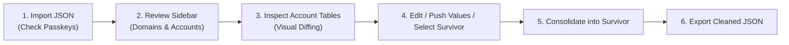

# Bitwarden Duplicate Cleaner

> **100% Local, Air-Gapped, Privacy-First Bitwarden Vault Deduplication & Consolidation**  
> Clean up duplicates, resolve discrepancies, preserve all passkeys (`fido2Credentials`), and consolidate messy vaults with absolute peace of mind.

---

## 🌟 Key Highlights & Design Philosophy

- **🔒 100% Local & Air-Gapped**: Runs entirely on `127.0.0.1:8765`. Zero network requests, zero telemetry, and zero third-party CDNs. Your passwords and passkeys never leave your local machine.
- **🔑 Passkey Protection & Validation**: Explicit detection of hardware passkeys (`fido2Credentials`). If you check *"I use passkeys in my vault"* but the file contains none, a prominent warning alerts you before you proceed. During merging, passkeys are unioned so no hardware credentials are ever lost.
- **🧠 Smart Account-Level Grouping**:
  - Automatically maps subdomains and service endpoints (e.g., `accounts.google.com`, `mail.google.com` $\to$ `google.com`).
  - Distinguishes multiple accounts under the same website (e.g., personal vs work) into distinct comparison tables.
  - Service-aware username heuristics: recognizes that for Google, `abc123`, `abc123@gmail.com`, and `abc.123+tag@googlemail.com` are the exact same account and groups them into one comparison table.
- **🔍 Visual Diffing & Column Sync**:
  - Discrepant cells (different passwords, notes, usernames) are highlighted in amber.
  - One-click **"Push to all"** button (`⇄`) allows propagating a chosen value across all duplicate rows in that column.
- **✏️ In-Place Cell Editing**:
  - Click **Edit** on any row to type or paste updated values with instant save/cancel.
- **🛡️ Survivor Consolidation**:
  - Pick your preferred master row.
  - Consolidates all passkeys, archives differing passwords to Bitwarden's `passwordHistory` array (so older passwords aren't lost), combines unique URIs and custom fields, and moves redundant entries to **Trash**.
- **↩️ Full Undo & Redo (Non-Destructive)**:
  - Every edit, merge, push, or delete is tracked in an in-memory transaction journal.
  - Use `Ctrl+Z` / `Ctrl+Y` or the navbar buttons to undo or redo any action.
  - Inspect the **Deleted Items** tab at any time to restore soft-deleted items with 1 click.
- **📦 Fail-Safe Export & Backup**:
  - Automatically saves an untouched timestamped `.bak` copy of your uploaded vault in `backups/`.
  - Exports a clean, standard Bitwarden JSON file ready for re-import.

---

## 🚀 Quick Start

### Prerequisites
- Python 3.9+ (Python 3.10, 3.11, 3.12, 3.15 supported)
- Node.js 18+ (only needed if building the frontend from source; the pre-built UI is already included!)

### 1. Launch the Application

#### On Windows:
Double-click `start.bat` or run:
```powershell
python run.py
```

#### On macOS / Linux:
```bash
chmod +x start.sh
./start.sh
```

The script will launch the local server on `http://127.0.0.1:8765` and automatically open your default browser.

---

## 📖 How to Export from Bitwarden with Passkeys

Passkeys are hardware-backed FIDO2 credentials. To ensure they are included in your export:

> [!CAUTION]
> **Never export as CSV for passkeys!**  
> Bitwarden CSV exports **strip all passkeys**, custom fields, and password history. You must export as **JSON**.

### Recommended Steps:
1. Open the [Bitwarden Web Vault](https://vault.bitwarden.com) in your browser.
2. Click **Tools** in the top navigation bar.
3. Select **Export Vault** from the left navigation panel.
4. Set **File Format** to:
   - **`.json` (Unencrypted)** — *Recommended for local processing with this cleaner.*
   - *(Optional: `.json (Password-Protected)`)*
5. Enter your Master Password and click **Export Vault**.
6. Save the downloaded `.json` file to your computer.

---

## 🖥️ User Workflow Walkthrough



### 1. Import Screen
- Drag and drop your exported Bitwarden `.json` file into the dropzone.
- Check the box: **"I use passkeys in my Bitwarden vault"**.
- If checked and no passkeys are found, an alert warning will appear allowing you to re-export or proceed knowingly.

### 2. Left Sidebar Navigation
- **Duplicate Groups**: Categorized by website domain (e.g. `google.com (2 accounts, 5 items)`).
- **Unique Logins**: Safe items with zero duplicates.
- **Modified & Merged**: Items updated during your active session.
- **Deleted (Trash)**: Soft-deleted items that will be excluded from export. Click **Restore** on any item to bring it back.

### 3. Website Comparison Tables
- When you click a website (e.g., `google.com`), you see a table for each unique normalized account:
  - **Survivor Radio**: Select which duplicate entry is the master.
  - **Amber Highlights**: Clearly indicate differing passwords, usernames, or notes.
  - **Hover Action**: Click `⇄` next to any discrepant cell to push that value across all rows in that column.
  - **Edit Button**: Turn any row into editable text fields for quick edits or copy-pasting.
  - **Consolidate Button**: Unions passkeys into the survivor, saves differing passwords into `passwordHistory`, combines notes, and sends duplicate entries to Trash.

### 4. Export & Re-Import into Bitwarden
1. Click **Export Clean JSON** in the top navigation bar.
2. Confirm the metrics and download your cleaned `.json` file.
3. In Bitwarden Web Vault:
   - Go to **Tools $\to$ Import Data**.
   - Select Format: **Bitwarden (JSON)**.
   - Choose the cleaned file and complete the import.
   - *(Tip: You can purge your vault under Settings $\to$ My Account $\to$ Purge Vault before importing, or import into a test organization/folder first).*

---

## 🧪 Testing & Verification

Run the comprehensive unit and integration test suite:

```bash
# Run all tests
python -m unittest discover tests
```

Tests cover:
- TLD and subdomain extraction (`extract_domain_from_uri`).
- Provider-specific username normalization (`google.com`, Gmail dots, `+` aliases).
- Deduplication grouping and cell diff flag calculation.
- Passkey unioning and `passwordHistory` archiving.
- Transactional Undo / Redo lifecycle.
- Schema compliance of the exported Bitwarden JSON.

---

## 🛠️ Project Structure

```
Bitwarden-Duplicate-Cleaner/
├── backend/
│   ├── app/
│   │   ├── consolidator.py   # Merging logic (passkey union, password history archiving)
│   │   ├── deduplicator.py   # Account grouping & cell diff detector
│   │   ├── main.py           # FastAPI routes & static file server
│   │   ├── models.py         # Bitwarden schemas & UI DTOs
│   │   ├── normalizer.py     # Domain eTLD+1 & email heuristic parser
│   │   ├── parser.py         # Vault parser, passkey validator, backup snapshot
│   │   ├── session.py        # Active state manager & undo/redo stack
│   │   └── static/           # Pre-built production frontend bundle
│   └── requirements.txt      # Python dependencies
├── frontend/
│   ├── src/
│   │   ├── api/client.ts     # Typed API client
│   │   ├── components/       # Table, Sidebar, Modals, Diff highlighters
│   │   ├── types/            # TypeScript definitions
│   │   ├── App.tsx           # Main application shell
│   │   └── index.css         # Tailwind styling
│   ├── package.json
│   └── vite.config.ts
├── tests/
│   ├── test_core.py          # Core normalization and deduplication tests
│   └── test_api_integration.py # End-to-end user workflow tests
├── run.py                    # One-click Python launcher
├── start.bat                 # Windows double-click runner
├── start.sh                  # macOS/Linux runner
└── README.md
```

---

## 🛡️ License & Privacy Assurance

This project is licensed under the MIT License. It is designed to be completely air-gapped: no analytics, no external servers, and no tracking. You are in complete control of your vault data.
