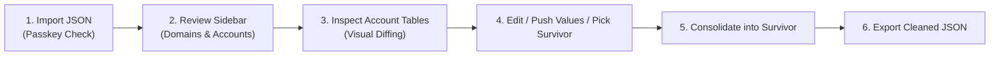

# 🛡️ Bitwarden Duplicate Cleaner

<div align="center">

[](https://www.python.org/)
[](https://fastapi.tiangolo.com/)
[](https://react.dev/)
[](https://tailwindcss.com/)
[](https://opensource.org/licenses/MIT)
[]()
[]()

**A 100% local, privacy-first, passkey-safe web application for deduplicating, diffing, and consolidating Bitwarden password vaults with absolute peace of mind.**

[Quick Start](#-quick-start) • [How to Export Passkeys](#-how-to-export-from-bitwarden-with-passkeys) • [Key Features](#-key-features) • [Workflow](#-interactive-workflow) • [Testing](#-comprehensive-test-suite)

</div>

---

## 🌟 Key Features

- **🔒 100% Local & Air-Gapped**: Runs entirely on `127.0.0.1:8765`. Zero internet access, zero telemetry, zero analytics, and zero cloud calls. All CSS, JavaScript, and fonts are bundled locally. Your credentials never touch the network.
- **🔑 Hardware Passkey Protection & Validation**:
  - Automatically parses and detects hardware passkeys (`fido2Credentials`).
  - Includes an import safety check: *"I use passkeys in my vault"*. If checked but no passkeys are found in the export, an alert warns you before proceeding.
  - When merging duplicate entries, all unique hardware passkeys across duplicate rows are unioned into the survivor so no passkeys are ever lost.
- **🧠 Account-Level Smart Normalization**:
  - Groups subdomains and endpoints to their root domain (`accounts.google.com`, `mail.google.com` $\to$ `google.com`).
  - Separates multiple distinct accounts under the same website (e.g. personal vs. work) into their own distinct comparison tables.
  - Recognizes provider username nuances: on Google, `abc123`, `abc123@gmail.com`, and `abc.123+tag@googlemail.com` are recognized as the same account and grouped into one table.
- **🔍 Visual Diffing & Column Sync**:
  - Highlights discrepant values (differing passwords, usernames, notes, TOTPs) in clear amber chips.
  - Direct plain-text password comparison in `font-mono` with one-click copy.
  - **Push Column Value (`⇄`)**: One-click sync button to propagate a chosen cell's value across all duplicate rows in that column.
  - **In-Place Row Editing**: Click `Edit` on any row to type or paste updated values with instant Save / Cancel.
- **🧹 Clean Dynamic Columns**:
  - Tables automatically hide empty columns if no duplicate row in that account possesses data for that field (e.g., if neither duplicate has TOTP, the TOTP column is omitted).
  - The **Unique Logins** page includes a **Three-Dots Menu (`⋮`)** allowing users to customize column visibility at any time.
- **🛡️ Survivor Consolidation & Password History**:
  - Pick your preferred master row.
  - Unions passkeys, appends non-empty URIs, merges notes, and automatically archives differing passwords to Bitwarden's `passwordHistory` so old credentials are never discarded.
  - Moves redundant entries to **Trash (Deleted Items)**.
- **↩️ Full Transactional Undo & Redo**:
  - Every action (merge, edit, push, delete, restore) is tracked in an in-memory transaction journal (`Ctrl+Z` / `Ctrl+Y`).
  - Inspect the **Deleted Items** tab at any time to restore soft-deleted items with 1 click before final export.
- **⚡ 1-Click Interactive Demo**:
  - Test out the application instantly without uploading your real vault using the built-in **"Load Demo Vault"** button.

---

## 🚀 Quick Start & Installation

You do **not** need Node.js, npm, or any complex build tools. The user interface comes pre-compiled and bundled directly with Python.

> [!TIP]
> **Isolated Virtual Environment (`.venv`)**:  
> To keep your system clean and avoid dependency conflicts with other software, this project is designed to run in an isolated Python virtual environment (`.venv`). Both 1-click launchers automatically set this up for you.

### Prerequisites
- **Python 3.9 or higher** ([Download from python.org](https://www.python.org/downloads/))
  - *Windows Users*: Make sure to check the box **"Add python.exe to PATH"** during Python setup!
- Any modern web browser (Chrome, Edge, Firefox, Brave, Safari)

---

### Method A: 1-Click Launch (Easiest — No Terminal Needed)

1. **Download the repository:**
   - Click the green **`<> Code`** button at the top of this GitHub page and select **[Download ZIP](https://github.com/zunaidFarouque/Bitwarden-Duplicate-Cleaner/archive/refs/heads/main.zip)**.
   - Extract the downloaded `.zip` folder anywhere on your computer.

2. **Run the 1-Click Launcher:**
   - **On Windows:** Double-click [`start.bat`](start.bat).
   - **On macOS / Linux:** Double-click [`start.sh`](start.sh) (or run `./start.sh` in terminal).

   *The script automatically creates an isolated `.venv` virtual environment, installs the required packages into it, and opens `http://127.0.0.1:8765` directly in your browser!*

---

### Method B: Command Line with Virtual Environment (Recommended for Developers)

1. **Clone the repository:**
   ```bash
   git clone https://github.com/zunaidFarouque/Bitwarden-Duplicate-Cleaner.git
   cd Bitwarden-Duplicate-Cleaner
   ```

2. **Create and activate the virtual environment:**

   - **On Windows (PowerShell / CMD):**
     ```powershell
     python -m venv .venv
     .\.venv\Scripts\activate
     ```

   - **On macOS / Linux:**
     ```bash
     python3 -m venv .venv
     source .venv/bin/activate
     ```

3. **Install dependencies inside the virtual environment:**
   ```bash
   pip install -r backend/requirements.txt
   ```

4. **Start the application:**
   ```bash
   python run.py
   ```

   Your default web browser will automatically open to `http://127.0.0.1:8765`.

---

### ❓ Frequently Asked Questions & Troubleshooting

<details>
<summary><strong>Q: Windows says "'python' is not recognized as an internal or external command"</strong></summary>

This means Python was installed without adding it to your system PATH.
1. Download Python from [python.org/downloads](https://www.python.org/downloads/).
2. Run the installer and click **Modify** (or uninstall and reinstall).
3. On the first installation screen, **check the box: `[x] Add python.exe to PATH`**.
4. Re-run `start.bat`.
</details>

<details>
<summary><strong>Q: Do I need Node.js or npm to use this?</strong></summary>

**No.** The production frontend bundle is already compiled and included in `backend/app/static/`. Node.js is only required if you wish to modify the React/Tailwind source code in the `frontend/` directory.
</details>

<details>
<summary><strong>Q: Can I run this with my Wi-Fi / Internet disconnected?</strong></summary>

**Yes!** The application is 100% self-contained. It strictly binds to `127.0.0.1` (localhost). You can unplug your Ethernet cable or turn off Wi-Fi and the entire deduplication, diffing, and export workflow will function without interruption.
</details>

---

## 📖 How to Export from Bitwarden with Passkeys

Passkeys are hardware-backed FIDO2 credentials. To ensure they are preserved in your export:

> [!CAUTION]
> **Never export as CSV if you use passkeys!**  
> Bitwarden CSV exports **strip all passkeys**, custom fields, and password history. You must export as **JSON**.

### Recommended Export Steps:
1. Log in to the [Bitwarden Web Vault](https://vault.bitwarden.com) in your browser.
2. Click **Tools** in the top navigation bar.
3. Select **Export Vault** from the left navigation panel.
4. Set **File Format** to:
   - **`.json` (Unencrypted)** — *Recommended for local processing.*
   - *(Or `.json (Password-Protected)` if preferred).*
5. Enter your Master Password and click **Export Vault**.
6. Save the downloaded `.json` file to your computer.

---

## 🖥️ Interactive Workflow



### 1. Import
- Drag & drop your Bitwarden `.json` file.
- Check *"I use passkeys in my Bitwarden vault"*.
- If you don't have a vault file handy, click **"Load Demo Vault"** to explore with pre-loaded mock data.

### 2. Compare & Diff
- Navigate the left sidebar by website domain.
- Each unique account under a domain has its own dedicated comparison table.
- Passwords are shown in plain text for easy comparison. Discrepancies are highlighted in amber.
- Hover over any cell to see full text in a tooltip if truncated.
- Hover over a discrepant cell to click `⇄` and push its value to all other duplicate rows.

### 3. Consolidate
- Select your preferred survivor row with the radio button.
- Click **"Consolidate into Survivor"**:
  - Combines all unique passkeys (`fido2Credentials`).
  - Appends non-empty URIs and notes.
  - Archives differing passwords to `passwordHistory`.
  - Sends redundant duplicate rows to **Trash**.

### 4. Re-Import Safely into Bitwarden
1. Click **Export Clean JSON** in the top navigation bar.
2. In the Bitwarden Web Vault, navigate to **Tools $\to$ Import Data**.
3. Choose format: **Bitwarden (JSON)**.
4. Select your downloaded `bitwarden_cleaned_export.json`.
5. *(Tip: Because Bitwarden appends imports, you can purge your vault under `Settings` $\to$ `My Account` $\to$ `Purge Vault` before importing, or import into a dedicated test folder/organization first).*

---

## 🧪 Comprehensive Test Suite

The project includes an exhaustive automated test suite covering unit tests, domain normalization permutations, username heuristics, passkey unions, state machine stress chains, and schema compliance:

```bash
# Run all 59 automated tests
python -m unittest discover tests
```

### Test Suite Breakdown:
- **`tests/test_core.py`**: Base parsing, passkey detection, diff calculation, and session undo/redo.
- **`tests/test_permutations_core.py`**: Exhaustive combinatorial tests covering all 28 country-code second-level domains (ccSLDs), subdomains, IPv4/localhost, app URIs, username heuristics, and passkey unions.
- **`tests/test_state_permutations.py`**: 12-step mutation stress chains, multi-domain isolation, branching history, and mathematical invariant verification.
- **`tests/test_bitwarden_export_schema.py`**: Round-trip import/export idempotency and official Bitwarden JSON schema validation for Logins, Cards, Secure Notes, and Identities.
- **`tests/test_api_integration.py`**: End-to-end FastAPI endpoint workflows and demo vault loading.

---

## 📁 Repository Structure

```
Bitwarden-Duplicate-Cleaner/
├── backend/
│   ├── app/
│   │   ├── consolidator.py     # Survivor merging (passkeys, password history, URIs)
│   │   ├── deduplicator.py     # Domain/account grouping & cell diff detector
│   │   ├── main.py             # FastAPI REST endpoints & static file server
│   │   ├── models.py           # Bitwarden schemas & UI DTOs
│   │   ├── normalizer.py       # eTLD+1 & provider username normalization
│   │   ├── parser.py           # Bitwarden JSON validator & backup generator
│   │   ├── session.py          # Session state manager & undo/redo stack
│   │   └── static/             # Pre-built production React bundle
│   └── requirements.txt        # Python backend dependencies
├── frontend/                   # React + TypeScript + Tailwind source code
│   ├── src/
│   │   ├── components/         # Table, Sidebar, Modals, Diff highlighters
│   │   ├── api/client.ts       # Typed API client
│   │   ├── types/              # TypeScript definitions
│   │   └── App.tsx             # Application shell
│   ├── package.json
│   └── vite.config.ts
├── demo/
│   └── sample_bitwarden_vault.json # Comprehensive 15-item sample vault
├── tests/                      # 59 automated tests
│   ├── test_core.py
│   ├── test_permutations_core.py
│   ├── test_state_permutations.py
│   ├── test_bitwarden_export_schema.py
│   └── test_api_integration.py
├── run.py                      # One-click Python runner
├── start.bat                   # Windows double-click launcher
├── start.sh                    # macOS / Linux launcher
├── LICENSE                     # MIT License
└── README.md
```

---

## 🔒 Security & Privacy Guarantee

- **No Remote Telemetry**: The application connects to no remote servers whatsoever.
- **Localhost Only**: The backend strictly binds to `127.0.0.1`.
- **Automatic Backup**: Every uploaded vault file is automatically preserved in an untouched, timestamped copy in `backups/` before any mutations take place.

---

## 👤 Author & Credits

Developed and maintained by **Md Zunaid Farouque** ([@zunaidFarouque](https://github.com/zunaidFarouque)).

---

## 📄 License

Distributed under the [MIT License](LICENSE). Copyright &copy; 2026 Md Zunaid Farouque.
